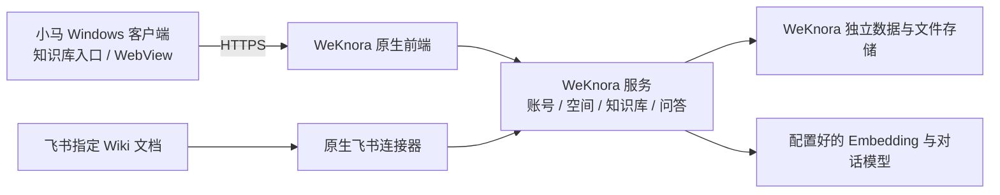

# 小马笔记接入 WeKnora 并连接飞书：MVP 开发任务书

> 日期：2026-11-06\
> 状态：WeKnora 已部署，云端笔记已索引；聊天知识库检索开关、测试服检索接口及 Windows Debug 构建已完成，实际模型回答待用户验收，飞书待接入\
> 适用范围：PonyNotes Windows 桌面客户端、独立部署的 WeKnora、飞书测试知识库\
> 是否影响服务端：新增 WeKnora 服务、云端笔记同步及经过小马身份/页面权限验证的检索入口\
> 实施原则：遵循 ponytail，先复用上游可运行能力，完成一条真实可验证的链路。

## 1. 目标与完成定义

当前执行顺序已按用户要求调整为：先部署 WeKnora，再接入小马所有云端笔记，随后配置模型与飞书。云端笔记桥接复用 Cloud 和 WeKnora API，每位用户使用独立原生账号/私人租户、每个工作区使用独立知识库，定时同步新增、修改、改名和删除。具体代码、安装命令、权限边界及运维见[部署文档的云端笔记同步章节](../../PonyNotes-Cloud-New/deploy/47.94.42.183/README.md)。

2026-11-06 首批已导入 3 位用户的 14 篇文档、2 个数据库结构和 10 条数据库记录，共 26 条知识内容；当前无随手记，5 个 AI 聊天会话不纳入笔记范围。尚无 Embedding，内容保持草稿，可查看正文，尚不可检索/问答。以下客户端与飞书部分仍作为后续任务书，不能视为已实现。

后续更新（2026-11-06）：Embedding 已配置，三个用户的笔记检索已通过。AI 欢迎页红框位置及会话输入栏新增「知识库检索」开关，开启后先检索当前用户/工作区的笔记，再使用原有聊天模型回答；默认关闭，聊天历史保留原问题。测试服的认证检索服务已部署并验证用户隔离。客户端开关测试、消息编码测试、debug/release/profile 环境配置测试通过；原有合并冲突已解决，Dart 事件接口已重新生成，缺失的云端版本历史 SDK 接口已补齐，Rust DLL 与 Windows Debug 完整构建通过。正式服模型配置已通过 SFTP 只读查找，仅将模型字段应用到测试服；DeepSeek、通义千问和豆包的最小真实调用均通过，客户端实际回答由用户后续验收。复现与运行说明见[部署文档的知识库检索及测试服聊天模型章节](../../PonyNotes-Cloud-New/deploy/47.94.42.183/README.md)。下文独立知识库页面与飞书部分仍为后续计划。

用户在小马笔记中打开「知识库」，登录 WeKnora，进入目标知识库。管理员配置飞书数据源并选择同步范围后，飞书文档进入 WeKnora，用户能够查看内容、搜索、提问并打开回答引用的来源。

本项目包含两项连续交付：

1. 小马笔记内可以实际使用 WeKnora 知识库。
2. 飞书文档可以通过 WeKnora 原生连接器进入指定知识库，完成首次同步和两轮增量验证。

必须交付可运行代码、可复现部署配置和真实联调记录。仅有入口按钮、能打开登录页、能取得飞书 token，均不算完成。

## 2. 已核实的现状

| 项目 | 当前情况 | 对实施的影响 |
| --- | --- | --- |
| 小马客户端 | Flutter + Rust；已依赖 `flutter_inappwebview`，白板等模块存在内嵌网页用法 | 复用现有 WebView 和插件导航机制 |
| WeKnora 相关代码 | `lib/plugins/knowledge_graph/` 移植了图谱抽取契约 | 现有图谱模块保持其职责；需要新增知识库服务接入 |
| WeKnora 服务集成 | 独立测试实例已部署；客户端尚未接入其页面或 API | 后续接入客户端入口并配置模型和飞书 |
| WeKnora 上游 | 已确认 `v0.9.0` 标签存在 Wiki 与 Drive 两种飞书连接器 | 复用原生同步、解析、索引、问答及数据源管理 |
| 当前客户端工作区 | 原有合并冲突及生成接口缺失已按用户要求修复，Windows Debug 构建通过 | 修改 Rust、Protobuf 或事件接口后，需先重建原生库，再运行 Flutter |

现有第三方授权表和 Notion ZIP 导入流程无需接到本链路。飞书内容的入库目标是 WeKnora，由 WeKnora 管理文档、来源信息和索引。

2026-11-06 部署验证：测试服 `47.94.42.183` 的独立目录 `/opt/ponynotes-weknora` 已运行官方 `v0.9.0` 五个核心服务，网页已开放公网地址 [http://47.94.42.183:18080](http://47.94.42.183:18080)，无需 SSH 隧道；后台服务仍绑定回环端口 `18081`，网页代理其 API。公网网页和认证配置接口、管理员登录、公开注册关闭、飞书连接器类型及容器重建后的账号保留均已验证，真实浏览器已进入知识库列表页。模型、飞书应用及实际同步尚未配置；复现和维护步骤见[部署文档](../../PonyNotes-Cloud-New/deploy/47.94.42.183/README.md)。

## 3. MVP 范围与取舍

### 本轮交付

- Windows 桌面端新增独立「知识库」入口，与现有「知识图谱」区分。
- 内嵌 WeKnora 原生网页，支持加载、失败重试、登录、知识库页面、资料查看、搜索、问答与引用跳转。
- 使用独立测试实例、一个试点空间和限定的测试用户。
- 沿用 WeKnora 独立账号登录；账号管理和空间成员权限使用其原生能力。
- 管理员通过原生数据源页面配置飞书企业自建应用的 App ID、App Secret，授权指定 Wiki 空间或节点。
- 首批保证新版云文档 `docx` 的正文接入，默认采用该版本连接器支持的 blocks 解析模式。
- 完成首次同步、手动增量、重命名去重、源文档删除、失败重试、同步状态查看和暂停同步。
- 计划同步采用 WeKnora 已有调度能力，在手动同步验证通过后启用并验证一个周期。

默认从飞书 Wiki 开始。若首批资料实际位于云盘，启动时将验收来源替换为原生 `feishu_drive` 连接器及一个具体文件夹；本轮只保证一种来源完整通过，避免同时扩大测试范围。

### 后续任务

| 能力 | 进入条件 |
| --- | --- |
| 小马与 WeKnora 单点登录、用户和工作区自动映射 | MVP 业务验证通过后设计正式身份体系 |
| 原生 Flutter 知识库页面 | 内嵌原生页面出现可复现的体验瓶颈 |
| 个人飞书一键 OAuth 授权 | 明确面向个人用户接入，而非管理员配置企业应用 |
| 小马自身笔记自动进入 WeKnora | 云端笔记同步已实施；向量索引待配置模型，本地未同步笔记和附件 OCR 暂不覆盖 |
| 飞书逐人、逐文档权限同步及撤权后停止检索 | 对外正式开放该使用场景之前完成，见第 6 节 |
| 移动端、macOS、Linux；复杂表格、附件、图片 OCR、多模态 | Windows 正文链路验收后按实际需求扩展 |
| 额外向量数据库、知识图谱服务、自研同步队列 | 实测证明默认部署能力不足 |

上游原生页面可能已暴露部分后续能力；页面上存在功能不等于本项目已验证并承诺支持。

## 4. 技术方案

### 4.1 部署与版本

- 以已核实的 `v0.9.0` 作为候选基线，先验证所需功能，再记录实际 tag、commit、镜像 tag/digest；部署不得依赖浮动 `latest`。
- 直接采用该版本官方 Compose，选用默认支持的检索后端和必需组件。组件清单、解析服务及资源用量以锁定版本和启动验证结果为准。
- WeKnora 使用独立数据库、持久化卷和配置目录。测试阶段不迁入、不复用小马现有业务表。
- 优先使用独立测试域名和 HTTPS，减少子路径、资源地址及 Cookie 路径兼容工作。域名由实际测试环境配置确定。
- 复用现有网关的部署方式；部署前核对机器容量与端口占用。此次任务书不构成已完成部署的声明。
- 配置可用的 Embedding 与对话模型并执行真实请求；模型维度与索引配置保持一致。Rerank 按原生要求配置，不新增自研模型路由。
- 密钥写入服务器配置或上游凭据管理，仓库仅保留脱敏示例。

### 4.2 客户端入口

- 建议新模块为 `frontend/appflowy_flutter/lib/plugins/knowledge_base/`，通过现有插件注册和侧边栏导航接入。
- 从环境配置读取 WeKnora 地址，复用项目 debug/release 区分环境的方式。
- WebView 只加载配置允许的 WeKnora 站点；来源引用等外部 HTTPS 链接交给系统浏览器，处理错误页与返回操作。
- 产品页面包含必要的加载、网络错误、重试与登录提示；用户能明确知道知识库使用独立账号。
- 保持现有「知识图谱」入口及笔记编辑功能；本轮不改其数据模型。
- 验证 WebView 在实际 Windows 打包程序中的运行条件、登录存储、中文输入、滚动、引用跳转及文件选择。提供 WebView 运行环境缺失时可理解的提示。

### 4.3 飞书数据源

- 使用 WeKnora 原生 `feishu` 数据源、资源选择树、同步任务、游标、日志与索引管线。
- 认证采用企业自建应用凭据换取 `tenant_access_token`。应用凭据有效与应用可读取目标资源是两项独立检查。
- 管理员发布应用版本，并将选定 Wiki 空间或节点授予应用访问；只授权专用测试资料。
- 为正文 blocks 路径核实 `wiki:wiki:readonly`、`docx:document:readonly` 等权限。素材下载使用 `drive:drive:readonly`，导出回退使用 `drive:export:readonly`；实际最小权限集按锁定版本和测试文档核对。
- 选用 Drive 时改为 `feishu_drive`，授权一个具体文件夹，并按该连接器要求配置只读权限；不沿用 Wiki 空间授权方式。
- 首次同步使用少量测试文档。确认解析和检索成功后，再增大范围和开启计划同步。
- 来源稳定标识、增量状态和同步日志由 WeKnora 保存。不得另建一套小马侧来源 ID 表、抓取器或定时队列。
- 对账以来源文档为准：同一外部文档最多一个当前有效主知识条目。允许上游更新时重建内部条目，但不能造成重复可检索正文或永久失效引用。

### 4.4 接口参考

MVP 内嵌页面使用 WeKnora 原生接口。以下是已核对的上游入口，实施时以锁定版本的路由和鉴权为准，不额外包装同名小马代理：

| 用途 | WeKnora 原生接口 |
| --- | --- |
| 查询连接器 | `GET /api/v1/datasource/types` |
| 创建与列出数据源 | `POST /api/v1/datasource`、`GET /api/v1/datasource?kb_id=...` |
| 测试连接 | `POST /api/v1/datasource/:id/validate` |
| 选择来源资源 | `GET /api/v1/datasource/:id/resources` |
| 手动同步 | `POST /api/v1/datasource/:id/sync` |
| 暂停、恢复 | `POST /api/v1/datasource/:id/pause`、`POST /api/v1/datasource/:id/resume` |
| 查看日志 | `GET /api/v1/datasource/:id/logs` |

这些请求使用 WeKnora 自身授权，不把小马 JWT 当作 WeKnora token，也不使用全体用户共享的管理员 API Key。

## 5. 实施任务及交付物

| 编号 | 工作内容 | 交付物与完成条件 | 粗估人天 |
| --- | --- | --- | --- |
| T01 | 锁定版本、确认 Wiki/Drive 来源与测试环境 | 记录版本、依赖、来源范围、模型和测试账号；验证候选版本具有目标连接器 | 0.5 |
| T02 | 部署独立 WeKnora 测试实例 | 可复现 Compose、脱敏环境示例、HTTPS 入口、持久化配置；重启后数据仍在 | 1–1.5 |
| T03 | 建立试点知识库及模型配置 | 导入一篇测试资料，完成解析、检索、问答和引用查看 | 0.5 |
| T04 | 新增小马知识库入口与内嵌页 | Windows 可运行页面、环境地址、加载/重试、导航与独立登录提示 | 1–1.5 |
| T05 | 配置飞书原生数据源 | 凭据与资源授权通过，能选中指定范围，首轮资料实际入库 | 0.5–1 |
| T06 | 验证同步、索引及异常恢复 | 第 7 节数据变更用例通过，保留脱敏同步日志与问题记录 | 1–1.5 |
| T07 | 核实会话隔离并完成交接 | 账号切换检查、部署与回退说明、联调记录、演示步骤 | 0.5–1 |

表内任务合计约 **5–7.5 人天**，单人建议预留 **1–2 个工作周**。这是采用原生界面和原生连接器的开发估算；飞书管理员审批、域名证书、模型服务故障及外部依赖等待时间单列。完整单点登录和逐人来源权限控制不计入本估算。

依赖顺序：`T01 → T02 → T03 → T05 → T06`；`T04` 可在 T02 后开展，T07 在客户端及同步链路完成后验收。

建议部署文件落在测试环境已有部署目录下的独立 `weknora/` 子目录；运行说明与验收记录放在本项目 `doc/`。实施时再确定具体文件，避免预先生成无用骨架。

## 6. 身份、权限与撤权边界

### 6.1 MVP 必须满足

- WeKnora 数据访问使用其原生账号和空间权限；试点知识库限定给确认有权读取全部试点资料的用户。
- 小马退出登录或切换账号时，关闭知识库页面，并隔离或清理该知识库会话。另一小马账号不能静默继承前一账号的 WeKnora 登录态；其他业务 WebView 的会话不能被误清理。
- 独立账号模式不自动建立“小马工作区 = WeKnora 空间”的等价关系；界面和交接文档写清实际登录身份。
- App Secret、WeKnora 管理密钥和模型密钥不进入客户端构建产物、URL、普通日志或验收截图。
- 凭据失效、权限不足、限流、资源列举失败必须在同步状态中可见。目录未能完整列举时，不得把全部已有资料误判为已删除。
- 暂停连接后不再启动新的计划拉取；正在执行任务的行为按锁定版本实际验证并记录。暂停、断开、删除源端文档三者分别验收。

### 6.2 原始撤权要求的后续上线门槛

“飞书里收回某个人对某篇文档的权限，小马中的 WeKnora 也不再向该人检索或展示”是独立的权限联动任务。应用级 token 和原生数据同步不能自动证明此要求已满足。

本轮需记录原生连接器在应用撤权、单文档撤权时的真实行为，包括已入库内容是否继续可检索，不能将同步失败当作检索权限已撤销。

向权限范围不同的用户正式开放前，另行完成：

1. 小马用户、WeKnora 主体与飞书身份的可信映射。
2. 来源权限变化的可靠检测、失效时限和查询时权限过滤。
3. 对文档预览、搜索、问答上下文、引用、缓存和资源下载统一执行控制。
4. 明确已经发送的回答和已下载的离线内容无法自动追回；定义产品可承诺的控制范围。

MVP 定位为限定授权用户的内部试点，不以此替代原始需求中的完整撤权验收。

## 7. 分阶段验收

### A. WeKnora 接入小马

| 编号 | 操作 | 通过标准 |
| --- | --- | --- |
| A01 | Windows 打包程序点击「知识库」 | 页面可用，能够登录和进入实际目标知识库；现有图谱入口正常 |
| A02 | 从原生页面加入一篇测试资料 | 解析与索引完成，搜索能找到内容，问答引用可打开 |
| A03 | 服务暂时不可达后恢复 | 出现可理解错误，重试可恢复；客户端不崩溃 |
| A04 | 重启客户端及 WeKnora 服务 | 知识条目和配置持久化；登录行为符合已说明的策略 |
| A05 | 小马退出或切换账号 | 后一账号无法自动读到前一账号的已登录知识库页面 |

### B. 飞书同步进入 WeKnora

准备专用飞书测试空间，至少 10 篇新版 docx，正文含可区分的测试事实；不得使用敏感生产资料。使用能控制权限和修改内容的测试账号，记录每篇源文档标识及预期结果。

| 编号 | 操作 | 通过标准 |
| --- | --- | --- |
| B01 | 连接测试成功后加载资源树 | 仅显示应用有权访问的测试范围，能够选择目标根节点 |
| B02 | 执行首次同步 | 选中范围的 10 篇测试正文入库、可检索；未选范围不进入知识库 |
| B03 | 增量第 1 轮：新增 1 篇，修改 1 篇已有正文 | 新资料出现，新事实可检索；旧版本独有事实不再作为当前正文参与新检索 |
| B04 | 增量第 2 轮：重命名 1 篇、删除 1 篇，并开启同步删除 | Wiki 重命名后来源对应的有效条目不重复；删除条目不再参与新检索或作为新回答引用 |
| B05 | 无修改再次同步 | 主知识条目数不持续增加，没有重复内容或无界重建任务 |
| B06 | 模拟凭据或资源授权错误 | 明确展示同步错误；已有资料不因列举失败而被批量误删；记录旧内容的可检索状态 |
| B07 | 恢复授权并重试 | 可恢复到正确范围；若原生版本需要全量重同步，步骤必须写入说明 |
| B08 | 启用原生计划同步并等待一个周期，再暂停 | 计划触发一次有效同步；暂停后不再创建新的计划拉取 |
| B09 | 用来自两篇飞书资料的问题提问 | 回答基于入库资料，至少能打开正确来源；无依据的问题不被当作已找到资料 |

若 T01 选择 Drive：使用对应文件夹样本替换 Wiki 样本。Drive 的目录改名/移动在上游文档中存在需全量同步的限制，必须验证并写明；不得照搬 Wiki 的增量目录行为。

验收区分“同步任务结束”“解析完成”“索引完成”。发生异步重建时，等待状态收敛后再检查结果；实际延时、模型、文档规模和配置一并记录，不预先承诺秒级更新。

### C. 最小自动验证及记录

- 客户端保留一项可运行的回归检查，覆盖知识库入口与 URL 导航限制等本次新增逻辑；会话隔离在真实 WebView 中补充人工验收。
- 复用上游连接器测试，不重新编写一套抓取器测试。只有实际修改连接器时，才为修改分支补充最小回归。
- 留下脱敏联调记录，包含 A/B 用例结果、首次与两轮增量的数量变化、失败恢复证据及已知限制。
- 没有真实飞书租户、模型或可用服务时，如实标记对应项“未验证”，不得用模拟响应替代联调通过。

## 8. 风险与应对

| 风险 | 本轮处理 |
| --- | --- |
| 源码、镜像和在线文档版本不同 | 锁定部署版本，依该版本验证；`main` 文档只作参考 |
| WebView 登录、外链或文件选择在打包程序失效 | 使用真实 Windows 安装/打包程序验收，不能只在普通浏览器验证 |
| 模型或解析组件不可用，任务完成但内容无法检索 | 先用单篇资料跑通解析、Embedding 和问答，再连接飞书 |
| 飞书 API 权限已开通但未发布，或资源未授权 | 分别测试凭据、目录可见性和正文读取，交接文档保留检查步骤 |
| 新版正文未被增量同步发现 | 使用已验证的原生更新时间/游标逻辑，必须通过正文变更用例；不把分页 token 当作变更游标 |
| 大范围导入、模型费用或主机容量超预期 | 先限定 10 篇正文样本，不启用无关部署组件或自动全库导入 |
| 源端权限变化后旧内容仍可访问 | 限定内部授权试点，记录真实行为，按第 6 节完成后续权限任务 |

## 9. 交接与回退

交接包包括：客户端变更、锁定版本部署配置、脱敏环境示例、飞书应用授权与同步操作说明、最小检查运行方式、联调记录和已知限制。

部署说明必须列出实际新增服务、域名、端口、存储卷、模型配置和密钥保存位置。备份范围包括 WeKnora 数据库、文件存储及凭据加密所需配置，备份内容本身不提交仓库。

回退时先暂停同步并保留 WeKnora 数据及配置，再回退客户端入口和网关新增配置。测试实例的数据迁移按锁定版本备份恢复；不以恢复旧镜像代替数据库迁移回退，不操作小马现有笔记业务数据。

任务完成汇报需明确：运行入口、部署版本、测试来源、已通过项、未验证项，以及是否仍限制为内部试点。

## 10. 实施前输入

以下输入在执行时从实际环境取得；缺少密钥不会阻止先完成客户端入口和脱敏部署模板：

- 可部署测试环境、测试域名与 HTTPS 配置。
- 可用的对话和 Embedding 模型端点及凭据。
- 飞书企业自建应用、能发布应用和授权 Wiki 的管理员、专用测试资料。
- WeKnora 试点账号和预期有权访问全部试点资料的用户范围。

本任务书默认 Windows 优先、独立账号、一个试点空间、Wiki docx 正文。执行人员可按这些默认值推进；部署与真实联调所需凭据通过既有安全方式提供。

## 11. 核查来源

2026-11-06 已核对以下公开资源。`v0.9.0` 源码用于候选版本判断，`main` 文档可能包含其后变化，不能据此假定所锁定版本拥有全部能力。

- [WeKnora v0.9.0 源码](https://github.com/Tencent/WeKnora/tree/v0.9.0)
- [v0.9.0 官方 Compose](https://github.com/Tencent/WeKnora/blob/v0.9.0/docker-compose.yml)
- [v0.9.0 飞书 Wiki 连接器](https://github.com/Tencent/WeKnora/blob/v0.9.0/internal/datasource/connector/feishu/wiki/connector.go)
- [v0.9.0 飞书 Drive 连接器](https://github.com/Tencent/WeKnora/blob/v0.9.0/internal/datasource/connector/feishu/drive/connector.go)
- [数据源使用与权限说明（main）](https://github.com/Tencent/WeKnora/blob/main/website-docs/03-features/10-datasource.md)
- [飞书云盘接入说明（main）](https://github.com/Tencent/WeKnora/blob/main/website-docs/03-features/24-feishu-drive.md)
- 本地现状：`frontend/appflowy_flutter/lib/plugins/knowledge_graph/WEKNORA_NOTICE.md`、`doc/bidirectional-links-client-design.md`、`frontend/appflowy_flutter/pubspec.yaml`。
